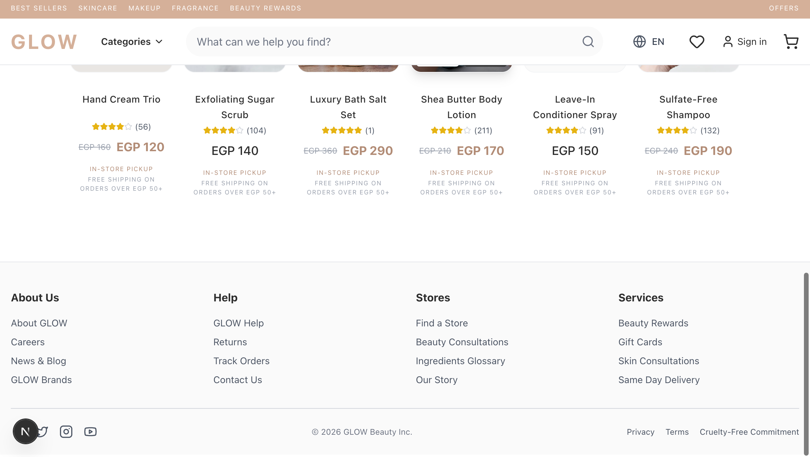
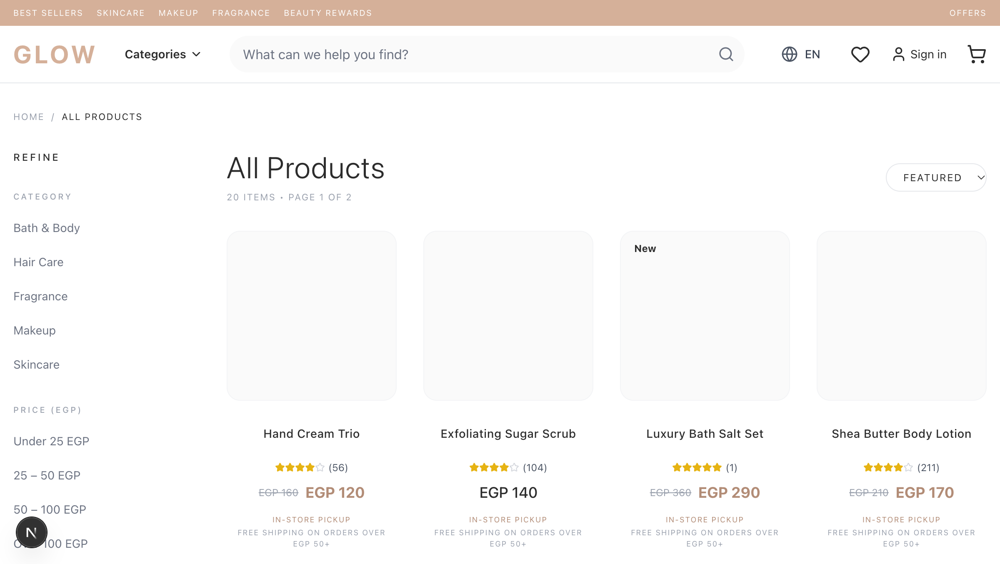
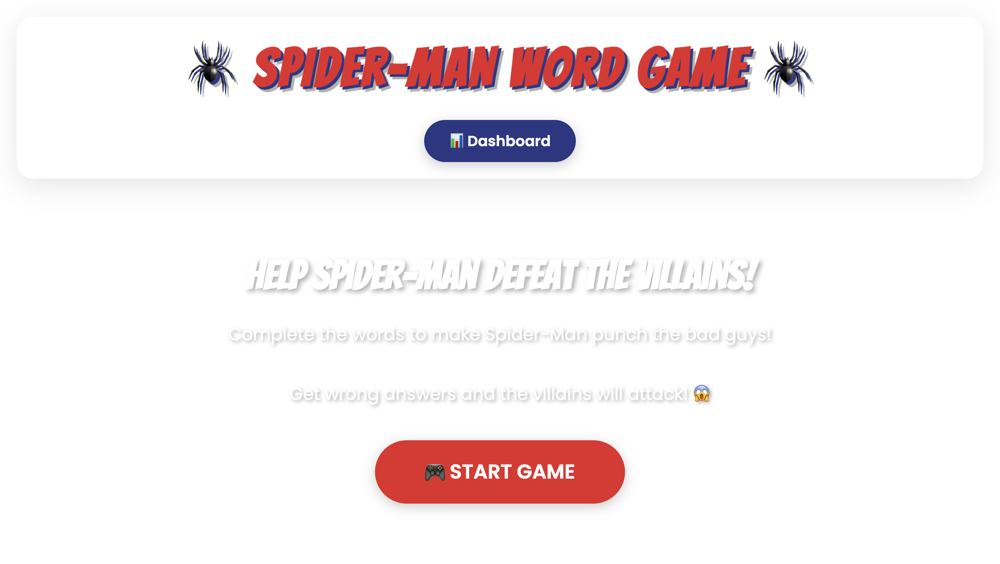
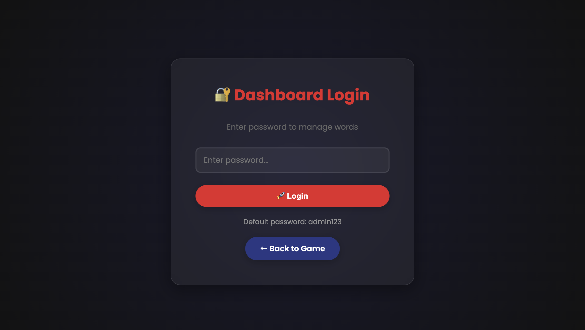

<!-- Fancy banner header -->

### Full-Stack Developer · Cairo 🇪🇬

I build **bilingual (Arabic/English)** products end-to-end — from Electron & Tauri desktop apps to Next.js e-commerce platforms.

  
  
  
  
  
  
  

---

### 🛒 Flagship — GLOW E-Commerce

  

Bilingual (EN/AR) e-commerce platform: **Next.js 16 · Prisma · NextAuth · reviews · wishlist · admin panel**

### 🏥 Hospital Operations Tracker

  
  
<em>Arabic-UI desktop app for supplies, surgeries & daily meds — Electron + SQLite</em>

### 🕷️ Spider-Man Word Game

  
  
<em>Educational game for kids — vanilla JS, zero dependencies, with a content dashboard</em>

---

### 📚 Other Work

| Project | Stack | What it is |
|---|---|---|
| [**ayadty**](https://github.com/mahmoudcod/ayadty) | Tauri · React · Rust · SQLCipher | Clinic management desktop app with licensing |
| [**hospital-full**](https://github.com/mahmoudcod/hospital-full) | Electron · React · TS | Hospital management with auto daily backups |
| [**mo7twa**](https://github.com/mahmoudcod/mo7twa) + [dashboard](https://github.com/mahmoudcod/mo7twa_dash) + [backend](https://github.com/mahmoudcod/mo7twa_backend) | Next.js · Express · Mongo | محتوى content platform (front, admin, API) |
| [**mohtawa-backend-hardened**](https://github.com/mahmoudcod/mohtawa-backend-hardened) | Express · helmet · rate-limit | Production-hardened API variant |
| [**mern-ordring-front**](https://github.com/mahmoudcod/mern-ordring-front) + [backend](https://github.com/mahmoudcod/mern-ordring-food-backend) | MERN | Food-ordering full-stack app |
| [**odysseus**](https://github.com/mahmoudcod/odysseus) | Python · Docker | Local-first AI assistant framework |
| [**ektesad**](https://github.com/mahmoudcod/ektesad-front) — front, [dashboard](https://github.com/mahmoudcod/ektesad-dashboard), [CMS](https://github.com/mahmoudcod/ektesad-strapi) | Vue · Strapi | Ektesad platform suite |
| [**money-board**](https://github.com/mahmoudcod/money-board) | Next.js | Finance dashboard |
| [**demoBlog**](https://github.com/mahmoudcod/demoBlog) + [blogFront](https://github.com/mahmoudcod/blogFront) | Strapi · Next.js | Blog platform (CMS + front) |

---

### 📊 GitHub Stats

  
  

  

